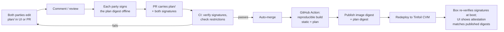
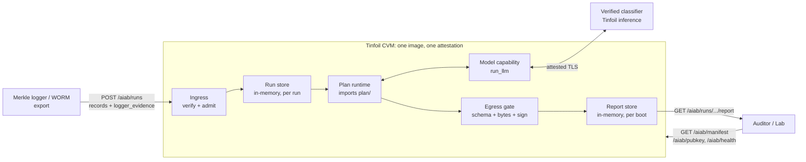
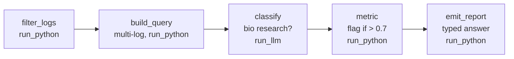

# AIAB (Auditor-in-a-Box): Design Spec

> Current implementation target, selected by the user after merging master. v0.5 is
> the first milestone; the [full requirements](REQUIREMENTS_COMPLIANCE.md) remain
> required afterward. See [BAKED_PLAN_OPERATIONS.md](BAKED_PLAN_OPERATIONS.md) for
> implemented contracts, commands, evidence and remaining dependencies.
>
> Implementation clarifications: folder bundles use `aiab-baked-plan/v1`, and
> expanded reports use `aiab-report/v3`, to avoid reusing deployed incompatible
> schemas. CPU hardware is the existing AMD SEV-SNP Tinfoil CVM. Signed exact-byte
> synthetic record exports remain the authorized logger substitute; native logger
> acceptance is incomplete. Offline verification uses an independently pinned
> live identity anchor, not a portable hardware endorsement of the report key.
> Tokenizer preflight checks all assembled queries before inference, asynchronously
> after admission; overflow is a signed failure. Idempotency is per authenticated
> role and boot.
> No persistence is not proof of memory erasure. The current build repository is
> private, so public-source compliance remains outstanding.

> Status: DRAFT v0.5 · Audience: internal team
> Owners: Jonathan Ng (static part) · Teddy Chang (dynamic part, UI) · Reviewer: Caleb Parikh
> Requirement IDs (F-, S-, C-, NF-, A-, OQ-) refer to *Caleb's proposal for the GDM demo* (13 Oct).
> `TODO(TC)` / `TODO(JN)` / `TODO(CP)` = owner to fill in · `DECIDE` = group decision needed · `JN TO DEFINE` = input/output protocol boxes left empty for Jonathan.
> v0.5 (15 Oct): repository layout and paths updated for the `static/`, `plan/`, `ui/` split.

---

## 1. Three parts

AIAB has two kinds of things: the structure of the box, which is fixed by hardware and security design, and the audit logic, which the lab and the auditor negotiate. The code is split along that line, with a UI on top.

- **Static part (owner: Jonathan), folder `static/`.** The box itself: how logs come in and are verified, how a plan is run and bounded, how encryption works, how the image is built and attested, and the contract every plan must satisfy (function signatures, `plan.json` schema, report envelope, restrictions). Does not change between agreements.
- **Dynamic part (owner: Teddy), folder `plan/`.** The audit logic, the prompts, the agreed settings and both parties' signatures. Changes with every agreement.
- **UI (owner: Teddy), folder `ui/`.** Where both parties edit, review and sign the plan, trigger the build, and see the attestation result.

Merits of the split:

- **Parallel work.** Jonathan builds the box against a stub plan; Teddy builds the plan against the local runtime. Neither needs the enclave until integration.
- **Small diffs per agreement.** A new agreement touches only `plan/`. The static code, its tests and its threat model stay fixed and are reviewed once.
- **One attestation.** Static part and plan are built into one image and attested together, so a change to either gives a new image digest (S-3). The split is a development method, not a security boundary.
- **Clear ownership.** The static part fixes every contract; the plan only fills in function bodies and settings. Negotiation is about plan content, never about the box.
- **UI is optional.** It is a front end over the repo and the box's read-only endpoints. The demo works without it. The box's own chat-demo front end, `static/webchat/`, ships with the box and is separate from it.

Repository layout:

```
aiab-introspection/
├── static/        the box: aiab/ auditor/ classifiers/ deploy/ tests/ traffic/ demo/ webchat/; Python project root (pyproject.toml, uv.lock, Makefile)
├── plan/          the plan (3.2)
├── ui/            the agreement UI (4)
├── docs/          specs
└── .dockerignore  image build allowlist; the build context is this directory so the image can copy static/ and plan/
```

Everything under `static/` runs from `static/`: `cd static && uv sync --locked && make check`. The image is built from the repository root: `static/deploy/Dockerfile` copies `static/aiab/` and `static/classifiers/` into `/app/` and, once the first plan exists, `plan/` into `/app/plan/`. `ui/` and `static/webchat/` never enter the image.

### 1.1 How the parts meet



---

## 2. Static part (owner: Jonathan)

### 2.1 Structure



- A run is one request carrying its complete input. Records live in memory for the run and are dropped once the report is signed. No encrypted storage and no ledger in the demo.
- Every client connection terminates inside the enclave on Tinfoil's attested TLS, as the classifier path already does. The host gateway sees plaintext and must not be on the ingestion path.
- Platform: Tinfoil CVM for the demo. TODO(JN): confirm the ingestion path and where TLS terminates on each link.

### 2.2 Encryption

- **Logger signing key.** Lives in the Logger TEE. Signs log batches; AIAB verifies them (F-1, A-2, S-6). TODO(JN): algorithm, key id, and how AIAB learns the trusted key (from config, never from the request).
- **Enclave report key (Ed25519).** Generated per boot inside the enclave (`static/aiab/keys.py`). Signs every report (F-7). Public key served at `GET /aiab/pubkey` and bound to the attestation through the manifest. Exists.
- **Party keys (lab and auditor, Ed25519).** Private keys stay off-box with each party; public keys are pinned in the static part. They sign the plan digest (3.2); CI and the box verify both signatures. In the demo.
- **Transport.** Tinfoil's attested TLS terminates inside the enclave for every client connection. Exists for the classifier path; TODO(JN) for ingestion.
- **At rest.** Nothing. Run input is held in memory and dropped after the report is signed; the F-2 storage key is post-demo.
- **Boot identity.** Report key and `boot_id` rotate together on restart; in-memory runs and reports are lost and clients resubmit. TODO(JN): key lifetime, F-13 wipe.

### 2.3 Ingress (F-1, C-4, S-6)

`POST /aiab/runs`. One request is one audit run with its complete input. No append, no seal step.

```json
{
  "submission_id": "demo-run-001",
  "plan_digest": "sha256:<digest of plan/ in the running image>",
  "input_scope": { "window_start": "...", "window_end": "...", "agents": ["agent-a", "agent-b", "agent-c"] },
  "records": ["<LogRecord>", "..."],
  "logger_evidence": "<JN TO DEFINE>"
}
```

`LogRecord`, the shape the plan sees, derived from the WORM format by a versioned transformation:

```json
{ "stream": "agent-a", "batch": 17, "offset": 40960, "agent_id": "agent-a", "session_id": "s-0003",
  "ts": "2026-10-15T09:12:44Z", "kind": "request | response | tool_call | tool_result", "content": "<utf-8 text>" }
```

Admission, in order, before any inference:

1. `plan_digest` matches the baked plan, else `invalid_plan`.
2. `logger_evidence` verifies: logger signature, chain continuity, checkpoint, else `invalid_logger_evidence`. (JN)
3. Every record is covered by the evidence and none is outside it; the commitment is over the exact bytes the plan consumes.
4. `input_scope` lies inside the plan's `input_scope` (window, agents, logger key), else `scope_mismatch`. This is the F-4 / S-5 scope check.
5. Bytes, record count and an exact context check of every classifier input are within limits, else `input_too_large`. Never truncate.
6. Bounded active and queued runs, else `capacity_exceeded`.

Response `202 {"run_id", "plan_digest", "status": "running"}`. Same `submission_id` with the same input returns the same run; a different input returns `409 submission_conflict`. Idempotency is per boot. Completeness is the Logger's job (A-7); AIAB verifies integrity only. DECIDE: require window-coverage evidence?

```
JN TO DEFINE: ingress protocol
1. logger_evidence JSON: fields, signature algorithm, key id, chain/Merkle proof shape, checkpoint. Link to WORM (OQ-3).
2. Push or pull: does WORM POST to AIAB, or does a client export and POST? Who runs it?
3. Submitter authentication for POST /aiab/runs (token, mTLS, signed request). Tailnet membership is not authentication.
4. WORM batch -> LogRecord mapping, versioned (agent_id, session_id, kind).
5. Live feed vs archive for the demo (OQ-3).
6. TLS termination for this endpoint; the host gateway never sees plaintext.
7. Size limits the box can accept (fills 2.7).
```

### 2.4 Scope (F-4, S-5)

There is no ad-hoc query endpoint. The only query is the plan baked into the image, so an out-of-scope query cannot run; the per-run scope check is step 4 above. No appeal endpoint in the demo: a corrected input is a new run, a different prompt is a new plan.

### 2.5 Egress (F-7, S-2, S-4, C-6)

`GET /aiab/runs/{run_id}/report`

| State | Response |
| --- | --- |
| RUNNING | `202 {"run_id", "status": "running"}` |
| COMPLETED | `200`, signed envelope with `result` |
| FAILED | `200`, signed envelope with `error` instead of `result`, so a failure is verifiable and cannot be hidden (S-4; F-5 "cannot answer") |
| Unknown, or lost on restart | `404`, never an all-clear |

```json
{
  "report": {
    "schema": "aiab-report/v2",
    "aiab_id": "...", "boot_id": "...", "run_id": "...",
    "image_digest": "sha256:...", "plan_digest": "sha256:...", "policy_digest": "sha256:...",
    "input_commitment": "sha256:<verified consumed records>",
    "status": "completed",
    "result": { "flagged": true },
    "egress_max_bits": 1
  },
  "signature": "<ed25519 over canonical_json(report)>"
}
```

The envelope is fixed; only `result` is governed by the plan's `output_schema`. Gate, once per run:

1. Validate `result` against `output_schema` (bounded subset only: boolean, enum, bounded integer, closed object, bounded string and array; no `$ref`).
2. `canonical_json(result)` within `limits.max_result_bytes`.
3. `egress_max_bits` computed from the schema before the run and shown (F-7). Not a lifetime budget: timing, failures and repeated runs are extra channels.
4. Sign with the enclave key; freeze. Fetching never re-runs the model.
5. Invalid output becomes `FAILED` with `invalid_output`; the value never leaves through reports, errors or logs.

Verification (`static/auditor/verify.py`, dispatch by `schema`, v1 untouched): key bound to the attested manifest, signature, `plan_digest` and `image_digest` equal the release, `input_commitment` equals the submitter's, `result` fits the auditor's own copy of `output_schema`. One offline command.

```
JN TO DEFINE: egress protocol
1. Who may GET a report (both parties) and by what mechanism.
2. Enclave key <-> attestation binding: the exact Tinfoil fields the auditor checks offline (F-11, A-4).
3. Transparency log: Rekor or none for the demo (C-6).
4. Ledger (F-10): none, or a minimal signed list of {run_id, status, plan_digest}?
5. Retention of reports; effect of a restart.
```

### 2.6 Status and operations

| Purpose | Endpoint | Status |
| --- | --- | --- |
| Health | `GET /aiab/health` | Exists |
| Image digest, plan digest, plan id, restrictions, model binding | `GET /aiab/manifest` (add `image_digest`, `plan_digest`, `plan_id`, `restrictions`) | Extend |
| Enclave report key | `GET /aiab/pubkey` | Exists |
| Fresh attestation (F-11) | Tinfoil attestation document | TODO(JN): how it is fetched and what it measures |
| Run an experiment, pipe data in and out | `POST /aiab/runs`, `GET /aiab/runs/{run_id}/report` | New |

`/v1/` stays the OpenAI-compatible chat proxy with its gateway token; everything AIAB-specific is under `/aiab/`. Tailscale: TODO(CP).

### 2.7 Static restrictions

Published inside the manifest. `plan.json` must fit inside it; CI checks at build, the box checks at boot and refuses to start on mismatch. At runtime a run that exceeds a limit is rejected, never truncated.

```json
{
  "version": "0.1.0",
  "hardware": { "tee": "TDX (Tinfoil CVM)", "gpu": "none; the classifier runs in Tinfoil's attested inference" },
  "models": [ { "id": "<tinfoil model id>", "artifact_digest": "sha256:TODO", "max_context_tokens": 0 } ],
  "limits": {
    "max_input_utf8_bytes": 0, "max_records_per_run": 0, "max_logs_per_query": 0,
    "max_model_calls_per_run": 0, "max_output_tokens_per_call": 512,
    "max_runtime_seconds_per_run": 0, "max_result_bytes": 0
  },
  "input_serialization_version": "TODO",
  "output_schema_subset": ["boolean", "enum", "integer(bounded)", "object(closed)", "string(maxLength)", "array(maxItems)"]
}
```

TODO(JN): real values. `artifact_digest` is a blocker: the current Tinfoil classifier alias is not a weight commitment, so C-2 needs a verified serving path or an explicit "blocked".

### 2.8 Plan runtime and inference

- Imports `plan` from `/app/plan`, loads `plan.json`, recomputes the plan digest and re-verifies both signatures; refuses to start on any mismatch.
- Calls the plan's functions in the fixed order of 3.1. The runtime owns records, limits, clock, model capability and signing; the plan owns only its function bodies.
- One callback: `run_llm(prompt_id, item) -> ClassifierResult`. The runtime loads `prompts/<prompt_id>.txt`, builds the system prompt, and calls the verified classifier with the existing generation parameters (temperature 0, strict JSON output). It enforces the model from `plan.json`, the call budget and the context check. Verification failure is `model_unavailable`; no mock fallback when deployed.
- Isolation: the plan is reviewed, signed code measured by attestation, so no interpreter. The container still gives it no network except the classifier, no filesystem beyond `/app/plan`, a wall-clock limit, and no access to keys, other runs or the envelope. TODO(JN): how other egress is blocked.
- Inference runs in Tinfoil's attested serving; the AIAB VM is CPU-only (OQ-7). TODO(JN): what the classifier side attests and whether it satisfies C-2.

### 2.9 Build and attestation (C-3, F-11, A-4)

- `static/deploy/Dockerfile` pins base images and dependencies; `static/deploy/reproducible-build.sh` gives the same image digest from the same commit. Add `COPY plan/ /app/plan/` with the first real plan.
- The build context is the repository root and the root `.dockerignore` is an allowlist: only `static/pyproject.toml`, `static/uv.lock`, `static/aiab/*.py`, `static/classifiers/*.md` and, once added, `plan/` enter the build. A new source folder needs new allowlist lines or it is silently left out. BuildKit records each instruction's text in the image config, so any Dockerfile edit changes the image digest even when every layer is identical.
- CI before build: recompute `plan_digest`, verify both signatures against the pinned public keys, check `plan.json` against 2.7. The release publishes the image digest and the plan digest.
- Digests, one meaning each: Tinfoil release/config digest (launches the image; checked by the attestation verifier), image digest (static + plan; attestation measurement vs. release), plan digest (`plan/` only; manifest, reports, the auditor's copy), policy digest (effective manifest; reports).
- Both parties rebuild from the commit and compare against their own pin, not the box's claim (A-4).
- TODO(JN): what Tinfoil's attestation measures, and how a new image is deployed from a release.

### 2.10 Run states and error codes

`RUNNING` → `COMPLETED` | `FAILED`; frozen afterwards.

| Code | HTTP | Where | Meaning |
| --- | --- | --- | --- |
| `invalid_plan` | 400 | admission | `plan_digest` does not match the baked plan |
| `unauthorized` | 401 | admission, retrieval | Not authenticated or not an agreed party |
| `invalid_logger_evidence` | 400 | admission | Signature, chain, checkpoint or record binding failed |
| `scope_mismatch` | 400 | admission | Outside the plan's `input_scope` |
| `input_too_large` | 413 | admission | Bytes, records or context budget exceeded |
| `submission_conflict` | 409 | admission | Same `submission_id`, different input |
| `capacity_exceeded` | 429 | admission | Job state full |
| `model_unavailable` | in report | execution | Classifier or its verification failed |
| `execution_failed` | in report | execution | Plan raised, timed out or exceeded the call budget |
| `invalid_output` | in report | gate | Result violated `output_schema` or byte limit |

Codes "in report" are returned in a signed `FAILED` envelope. They are also the fixed reason list for "cannot answer" (F-5, OQ-4). Never return raw exceptions, prompts or record text.

---

## 3. Dynamic part: the plan (owner: Teddy)

> **Implemented form (v0.6).** The plan is now the graph of 3.3, not the fixed functions of
> 3.1 and 3.4: one `plan/plan.json` (format `aiab-plan-ir/v0`) of five block types (Input
> Logs, Classifier, Run Python, Run LLM, Final Report), checked by `static/aiab/baked/plan_ir.py`,
> run by `graph.py` in the sandboxed worker, with every model call built and made by the box
> (S-8 holds: the box's framing comes first, the plan's instructions after it). The report's
> fields are the output schema; only Classifications aggregates and declared Value fields can
> be released. The plan is written in the agreement UI's builder, which applies the same checks.
> The text below is the earlier design and remains the rationale.

### 3.1 How the static and dynamic parts connect

It is not frontend and backend. The static part is the program that runs; the plan is a plugin it loads. The static part decides which functions a plan must provide and in what order they are called; the plan only fills in what those functions do. The plan calls back into the static part for one thing only: model inference.

```python
# static part, once per admitted run
cfg     = load_plan_json("/app/plan/plan.json")           # checked at build and at boot
records = run.records                                     # verified at ingress (2.3)
records = plan.filter_logs(records, rules=cfg.filter)
queries = plan.build_query(records, window=cfg.window)    # within limits.max_logs_per_query
scores  = [plan.classify(q, model_id=cfg.model.id, prompt_id=cfg.classification.prompt_id)
           for q in queries]                              # each call goes through run_llm (2.8)
verdict = plan.metric(scores, threshold=cfg.classification.threshold)
result  = plan.emit_report(verdict)                       # must match cfg.output_schema
egress_gate.check_and_sign(run, result)                   # 2.5
```

### 3.2 Plan bundle: layout, signing, baking

```
plan/
├── __init__.py
├── plan.py            # the six functions (3.4)
├── plan.json          # agreed settings (below)
├── prompts/
│   └── bio_research_v1.txt   # pinned verbatim, referenced by prompt_id
├── tests/
│   ├── transcripts/   # synthetic LogRecord files, one run per file; not part of the digest
│   └── expected.json
└── signatures/
    ├── lab.sig        # Ed25519 signature over the plan digest
    └── auditor.sig
```

```json
{
  "schema": "aiab-plan/v1",
  "plan_id": "bio-demo-001",
  "restrictions_version": "0.1.0",
  "parties": { "lab": "<key id>", "auditor": "<key id>" },
  "input_scope": { "logger_key_id": "<trusted logger key id>", "window_start": "...", "window_end": "...", "agents": ["agent-a", "agent-b", "agent-c"] },
  "filter": { "keywords": ["train"], "kinds": ["request", "response", "tool_call"] },
  "window": 8,
  "model": { "id": "<tinfoil model id>", "artifact_digest": "sha256:TODO", "temperature": 0, "max_output_tokens": 512 },
  "classification": {
    "problem": "Is this agent doing biological research?",
    "positive_examples": ["<TODO(TC)>"], "negative_examples": ["<TODO(TC)>"],
    "prompt_id": "bio_research_v1", "threshold": 0.7,
    "evaluation": { "test_set_digest": "sha256:<plan/tests>", "results_digest": "sha256:<dry-run record>" }
  },
  "limits": { "max_input_utf8_bytes": 100000, "max_records_per_run": 2000, "max_logs_per_query": 8,
              "max_model_calls_per_run": 64, "max_runtime_seconds_per_run": 120, "max_result_bytes": 1024 },
  "output_schema": { "$schema": "https://json-schema.org/draft/2020-12/schema", "type": "object",
                     "properties": { "flagged": { "type": "boolean" } }, "required": ["flagged"], "additionalProperties": false }
}
```

Numbers are proposals, not measured capacity. Strings are kept byte for byte. Every field changes the decision, so every field is signed.

How a plan becomes the running plan:

1. **Digest.** `plan_digest` = sha256 over the sorted paths and contents of `plan/`, excluding `static/tests/` and `signatures/`.
2. **Sign.** Each party runs `aiab plan sign` on its own machine with its own private key and gets `signatures/<party>.sig`. Private keys never touch the repo, CI or the box.
3. **PR.** The UI or CLI opens the pull request carrying `plan/` and both signature files. GitHub approvals are not the trust mechanism; the PR is transport and history.
4. **CI.** Recomputes the digest, verifies both signatures against the public keys pinned in the static part, checks `plan.json` against the restrictions (2.7), merges automatically.
5. **Bake.** The build copies `plan/` into the image. The release publishes the image digest and the plan digest.
6. **Boot.** The box re-verifies both signatures and refuses to start otherwise (2.8).
7. **Verify.** Anyone clones the released commit, recomputes the digest, checks the signatures, rebuilds the image and compares it with the attestation. Every report carries the plan digest.

A new agreement repeats 1 to 6. A plan is never edited in place. The plan never names the image digest, so there is no circularity: the image digest covers the plan.

### 3.3 The plan as a graph

Caleb's proposal (F-3, C-5) calls the plan a computation graph of `run_python` and `run_llm` steps across input, query and output stages. The demo plan is a straight line; later plans may branch (several classifiers voting, several report questions, an appeal path).



### 3.4 Library API

Types are fixed by the static part in `static/aiab/plan_api.py` (frozen dataclasses). The plan imports them and defines none of its own.

```python
LogRecord(stream, batch, offset, agent_id, session_id, ts, kind, content)      # 2.3
QueryInput(records: tuple[LogRecord, ...], agent_id: str | None, session_id: str | None)
ClassifierResult(score: float, label: str)   # parsed by the runtime from the model's strict JSON
Verdict(flagged: bool, n_queries: int, n_flagged: int, max_score: float)
FilterRules(keywords: tuple[str, ...], kinds: tuple[str, ...], agents: tuple[str, ...] | None)
```

`plan.py` may import only `dataclasses`, `typing` and `aiab.plan_api`; no network, file, environment, clock or randomness; deterministic for the same inputs; the only external call is `run_llm`, at most `limits.max_model_calls_per_run` times. CI rejects anything else.

**Filter**: which logs are in scope

```python
def filter_logs(logs: list[LogRecord], *, rules: FilterRules) -> list[LogRecord]:
```
- Demo default: keyword prefilter, e.g. "train". TODO(TC): finalize `FilterRules`.

**Query**: group logs into classifier inputs

```python
def build_query(logs: list[LogRecord], *, window: int) -> list[QueryInput]:
```
- Must support multi-log queries, the reason the TEE is needed. Within `max_logs_per_query`; an input over the model context is rejected by the runtime, never truncated. TODO(TC): grouping strategy (by agent, by session, sliding window).

**Classification** (F-5, C-2, S-8)

```python
def classify(item: QueryInput, *, model_id: str, prompt_id: str) -> float:
    return run_llm(prompt_id, item).score
```
- Score in [0, 1], uncalibrated. `model_id` must equal `plan.json.model.id` and be in the restrictions. Record content is evidence, never instructions (S-8): the runtime's system prompt says so and the plan cannot change that framing.
- Demo: "is this agent doing biological research?", one model. TODO(TC): one control technique from the literature for the next version.

**Metric**: scores to verdict

```python
def metric(scores: list[float], *, threshold: float) -> Verdict:
```
- Demo: flag if any score > 0.7. DECIDE: any vs fraction vs count.

**Report** (F-6, F-7, NF-4)

```python
def emit_report(verdict: Verdict) -> dict:
```
- Must validate against `output_schema`; typed answers only. "Cannot answer" is not produced here; it is the signed `FAILED` envelope with a reason code (2.10).
- Demo: `{"flagged": bool}`. TODO(TC): Caleb's Q1 band (fraction of sessions) when the test set supports it.

**Appeal** (F-9, S-7), post-demo

```python
def appeal(flag_id: str, *, kind: Literal["data_correction", "secondary_query"]) -> Verdict:
```
- Not called in the demo. TODO(TC): window, who may appeal, attempt cap (OQ-6).

**Dry run** (F-14)

- From `static/`, `python -m aiab.dryrun ../plan` runs the plan on `plan/tests/` with the local runtime and prints confusion counts with denominators, FPR and FNR; its record's digest goes into `plan.json.classification.evaluation`. Iterate with `MockClassifier`; re-run with the real verified classifier before signing, with model settings frozen.
- TODO(TC): synthetic transcript set. TODO(CP): whether a coup-example dataset from Tyler / Redwood can feed it.

---

## 4. UI (owner: Teddy)

Lives in `ui/`, outside the image. The box's chat-demo front end in `static/webchat/` visualizes the `/v1` proxy path and is not part of this UI.

### 4.1 Style

- Match the current Lucid UI. TODO(TC): link the reference, list colors, fonts and components to reuse.

### 4.2 Screens

1. **Plan editor.** A form per library block (filter, query, classifier, metric, report) that edits `plan.json` and `plan.py`, plus a raw view. The graph from 3.3 is drawn live.
2. **Review.** Comments per field or line, per party. Diff between versions.
3. **Validation.** Live check of `plan.json` against `restrictions` from `GET /aiab/manifest`, the same check CI runs.
4. **Dry run.** The evaluation record from 3.4.
5. **Sign.** Shows the plan digest; each party produces its signature file with the CLI and uploads it. The UI opens the PR once both are present.
6. **Build and attest.** Build progress, published image digest and plan digest, and whether the running box's attestation and manifest match both.
7. **Runs.** Submit a run, poll its report, show the signed result or the error code, and `egress_max_bits`.

### 4.3 Signing

- Trust comes from the two Ed25519 signatures over the plan digest (3.2), not from GitHub. The UI never holds a private key; it only collects signature files and opens the PR.
- Both parties can still comment in the PR, so the negotiation history lives in GitHub.
- CI merges when both signatures verify and the restrictions check passes. Nobody clicks merge.
- Public keys are pinned in the static part. Rotating a party key is a static-part change, built and attested like any other.

### 4.4 After merge: build and redeploy

1. A GitHub Action runs the reproducible build, pushes the image, and publishes the image digest and plan digest in a release.
2. Something outside the TEE pins the new image in the Tinfoil release config and restarts the CVM. Attestation proves what is running, so the deployer need not be trusted.
3. The UI polls `GET /aiab/manifest` and the attestation and shows green when both digests match the release.

- Never run a GitHub Actions runner inside the CVM; it would let GitHub execute commands in the box (C-3).
- Runs and reports are in memory, so a redeploy loses in-flight runs and unfetched reports. Fetch reports first; resubmit afterwards (OQ-5).
- TODO(JN): whether Tinfoil can deploy from a GitHub release.

---

## 5. Demo baseline

UI comes after the first integration. Minimum that must work:

1. Build the image with `plan/` baked in (bio classifier, threshold 0.7); publish image digest and plan digest.
2. Deploy on Tinfoil; `GET /aiab/manifest` shows both digests and the attestation matches the image digest.
3. Export a few agents' logs with logger evidence; `POST /aiab/runs`; the six admission checks pass.
4. Filter, multi-log query, bio classifier, flag above 0.7, typed report.
5. `GET /aiab/runs/{run_id}/report`; `auditor verify` passes offline against the release and the auditor's copy of `plan/`.
6. Negative paths: altered record → `invalid_logger_evidence`; oversized window → `input_too_large`; swapped image → attestation red; out-of-schema result → signed `FAILED` with `invalid_output`.

For this first version the plan can be baked in by hand, signed with locally generated keys, as long as the layout in 3.2 is followed. The logger evidence verifier must be built against real logger fixtures; until then step 3 is explicitly incomplete, not mocked as passing.

## 6. Open questions

- DECIDE: classification target. Bio research per the 14 Oct meeting; TODO(CP) to confirm in writing.
- DECIDE: transparency-log publication in the demo (2.5); window-coverage evidence or A-7 (2.3); metric aggregation (3.4).
- JN TO DEFINE boxes in 2.3 and 2.5.
- Blockers: model artifact digest for C-2 (2.7); Tinfoil redeploy from a release (4.4); the logger's real evidence format (2.3).
- OQ-3, OQ-4, OQ-6, OQ-8 from Caleb's proposal.

## 7. Out of scope for the demo

- F-2 sealed storage, F-13 wipe, F-8 release review, F-9 appeals, F-10 ledger, F-12 live-vs-archive.
- S-2 as an enforced lifetime bit budget; only the per-report maximum is computed and shown.
- Branching plans, model ensembles, trusted randomness over models, GPU confidential computing inside the AIAB VM.
- Runtime plan registration and the restricted interpreter; continuous ingestion; durable cross-restart state.

## 8. Requirement coverage (Caleb's proposal, 13 Oct)

Status: **C** covered in the demo design · **P** partly covered · **B** blocked on a dependency · **O** out of the demo (section 7).

| ID | Requirement, short | Where | Status |
| --- | --- | --- | --- |
| A-1 | TDX isolation and attestation hold | 2.1, 2.9 | C |
| A-2 | Logger TEE key is honest | 2.2, 2.3 | C |
| A-3 | Auditing model not jailbroken while useful | 3.4 (S-8 framing) | C, assumption kept |
| A-4 | Both parties rebuild and verify against their own pin | 2.9, 3.2 step 7 | C |
| A-5 | Plan negotiation is off-box; AIAB only enforces a signed plan | 3.2, 4.3 | C |
| A-6 | Public transparency log available | 2.5 | DECIDE |
| A-7 | Delivered logs are complete; completeness is the Logger's job | 2.3 | C, DECIDE on coverage evidence |
| A-8 | Tool results may be false; AIAB checks consistency only | not addressed | O (OQ-9) |
| F-1 | Ingest signed batches, verify signature and chain, record rejections and chain head | 2.3, 2.10 | P: one-shot export, no live feed, no ledger; format JN |
| F-2 | Sealed storage under a per-inspection key | 2.2 | O |
| F-3 | Exactly one co-signed plan; LLM steps pin model and prompt; Python signed verbatim; output contract fixed | 3.2, 3.3, 3.4, 2.8 | C; model hash B (C-2) |
| F-4 | Auditor queries checked against scope before running; rejections logged with a reason | 2.4, 2.3 step 4, 2.10 | C by construction; no ledger |
| F-5 | Deterministic programs over N agents' sessions; LLM only where the plan says; "cannot answer" with fixed reason | 3.1, 3.4, 2.10 | C |
| F-6 | Typed answers only | 2.5, 3.4 | C |
| F-7 | Egress gate: contract check, max bits before the run, enclave signature, digest to transparency log | 2.5 | C except transparency log (DECIDE) |
| F-8 | Developer release review | 2.5 | O (OQ-8) |
| F-9 | Appeals | 3.4 | O |
| F-10 | Hash-chained signed ledger | 2.5 JN box | O |
| F-11 | Fresh attestation on every connection, checked against the verifier's pin | 2.6, 2.9 | P: TODO(JN) on Tinfoil fetch and fields |
| F-12 | Live-vs-archive check | struck by Caleb | O |
| F-13 | Retention and wipe | 2.2 | O (nothing at rest) |
| F-14 | Plan builder with dry run and FP/FN | 4.2, 3.4 | P: dry run in demo, builder after |
| S-1 | Confidentiality: nothing outside the enclave reads raw logs, intermediates or model outputs | 2.1, 2.8, 2.5 | C; ingestion TLS TODO(JN); classifier inside Tinfoil's attested serving |
| S-2 | Bounded egress per run | 2.5 | P: per-report maximum computed and shown, not enforced over time |
| S-3 | Neither party alone can change plan, step, model or prompt | 3.2, 2.9 | C |
| S-4 | Signed report cannot be altered; withholding is visible | 2.5 | P: signed and failures signed; visibility needs the transparency log |
| S-5 | Out-of-scope query never runs | 2.4 | C |
| S-6 | Unsigned, re-signed or chain-broken logs rejected | 2.3 | C, format JN |
| S-7 | Appeals cannot widen scope | 3.4 | O with F-9 |
| S-8 | Log content cannot change plan, scope or contract | 3.4, 2.5, 2.8 | P: structural part covered; ensembles and per-party filters out |
| S-9 | Nothing readable after wipe | 2.2 | C trivially: nothing persists |
| S-10 | Every party action is a signed ledger entry | 3.2 signatures, 2.3 auth | P: plan actions attributed by signature; run submission auth JN; no ledger |
| C-1 | Intel TDX CVM for all software | 2.1 (Tinfoil CVM) | C |
| C-2 | Open-weight auditor model pinned by hash | 2.7 | B: Tinfoil alias is not a weight digest |
| C-3 | Open source, reproducible build, no admin login, no debug interface | 2.9, 4.4 | P: TODO(JN) confirm no SSH or shell in the deployed CVM |
| C-4 | Inputs in the Logger/WORM signed batch format | 2.3 JN box | JN |
| C-5 | Plan as run_llm / run_python steps across stages | 3.3 | C |
| C-6 | Report digests to a public transparency log | 2.5 | DECIDE |
| NF-1 | 3 agents demo, 100 target | 2.3 input_scope, 2.7 limits | P: demo scale only |
| NF-2 | One report per run or day; appeal window; latency bound | one-shot runs | P: no cadence; TODO latency figure |
| NF-3 | Retention until the challenge window closes | 2.2 | O |
| NF-4 | Report a few thousand bits at most | 2.5 | C |
| NF-5 | A stopped box is visible as a missing report | none | O: needs a cadence |
| NF-6 | One TDX server; model fits compute | 2.8 | C via Tinfoil's attested inference (OQ-7) |
| NF-7 | Plan builder usable without crypto expertise | 4.2, 4.3 | P: CLI signing in the demo, UI wraps it later |

Caleb's ten demo steps against section 5:

| Step | Caleb's demo | Here |
| --- | --- | --- |
| 1 | Draft and sign in the UI after a dry run | Sign with the CLI; dry run yes; UI later |
| 2 | Attendee verifies the attestation on their phone | Manifest + attestation vs. release (TODO(JN) on the quote) |
| 3 | Logs stream in; ledger shows chain heads advancing | One export, one run; no ledger |
| 4 | Q1 band, Q2 logging tampered, Q3 live vs archive | Q1 as `flagged`; band TODO(TC); Q2, Q3 out |
| 5 | Out-of-scope auditor query rejected and logged | No query endpoint; rejected by construction |
| 6 | Gate passes; byte counter; digest on transparency log | `egress_max_bits` shown; transparency log DECIDE |
| 7 | Prover releases or withholds the report | Out (OQ-8) |
| 8 | Swapped binary turns attestation red; agent C's tampering surfaces | Attestation red yes; tampering detection out (Q2, Q3) |
| 9 | Appeal clears a wrong flag | Out |
| 10 | Signed wipe, attested destruction event | Out |
