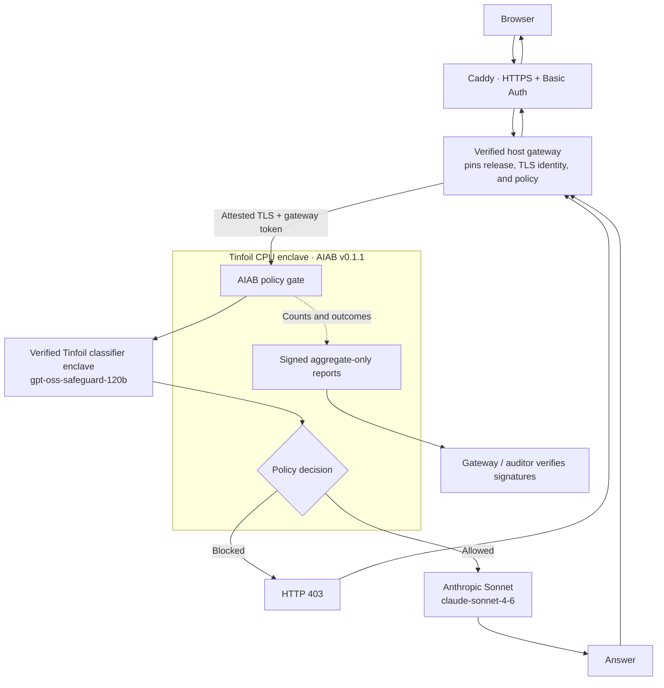

> This is the README of the box (the static part). Run every command below from `static/`.
> Repository overview and the three-part layout: [../README.md](../README.md).

# AIAB inference introspection

AIAB ("AI in a box") puts a policy gate in front of model inference and produces
signed aggregate audit reports. The [live hosted chat](https://jonathan.quest/aiab-introspection/)
routes through a release-pinned verification gateway to AIAB running in a Tinfoil
CPU enclave. AIAB uses Tinfoil's verified production classifier
(`gpt-oss-safeguard-120b`) to check each admitted conversation. Policy-blocked
requests stop at AIAB; allowed requests are forwarded to Anthropic Sonnet
(`claude-sonnet-4-6`) for an answer.

## Live hosted information flow



Responses return through the same verified gateway and Caddy route. Caddy serves
the webchat assets, preserves Basic Auth, and sends only API requests to the
loopback gateway. Before every accepted request the gateway verifies the enclave's
release, TLS identity, manifest, and independently approved policy. There is no
automatic mock fallback: verification or classification failure closes admission.

**Verification boundary:** AIAB runs in the measured Tinfoil CPU enclave. Release
`v0.1.1` uses CVM `0.14.9`; the approved Tinfoil release digest is
`34b158a1d180c004daa1e0fde014848726be04c0b4506da6b6ed861ee264496c`, and the
approved policy digest is
`8d03b314f111446aba77f1b944fda015919b0e0e222b0026b9057fee47cc1092`.
The classifier connection is separately verified by the Tinfoil SDK. The browser,
Caddy, and host gateway remain outside the enclave and can see plaintext. Anthropic
receives allowed conversations over ordinary HTTPS and is not enclave-attested.
Reports contain aggregate counts, not conversation transcripts.

Caddy and the host operator can access conversations. Every admitted conversation
reaches the Tinfoil classifier; only policy-allowed conversations reach Anthropic.
The browser keeps history in page memory and resends successful turns with the
next message. AIAB does not persist transcripts or include them in audit reports;
this is not a claim about external providers' retention. Basic Auth controls access,
but the application has no per-user quota or billing cap. See the
[host deployment and routing guide](deploy/HOSTING.md).

## What this demonstrates

The hosted service demonstrates an attested AIAB policy gate, real classification,
policy enforcement, answer inference, and signed aggregate reporting for traffic
admitted at this proxy.
It does not establish datacenter-wide coverage, absence of prohibited activity,
or the fraction of compute spent on AI research. Other endpoints and internal
agent activity are outside the observation boundary. A preset prompt being blocked
does not demonstrate robust detection of adversarial or distributed capabilities
research. Exact counts can disclose information in small periods; there is no
differential privacy or general covert-channel guarantee. Use the supplied
synthetic presets for walkthroughs. See the [threat model](docs/THREAT_MODEL.md),
[deferred work](docs/DEFERRED.md), and [open questions](docs/OPEN_QUESTIONS.md).

## Development and testing

The local development stacks use a keyword mock classifier and local llama.cpp
inference unless explicitly configured otherwise. These are testing configurations;
the hosted service above uses the Tinfoil and Anthropic overlays. Offline tests
exercise provider integrations and failure handling; they do not measure live
provider accuracy or latency. See [the implementation plan](aiab-plan.md).

Use Python 3.12 and `uv`. Dependency versions are resolved in `uv.lock`.
`make sync` installs the locked environment; `make check` runs Ruff lint, format
verification, and pytest. Package commands are `aiab` and `auditor`.

Local workflows: `make local-up`, `make traffic`, `make eval`, and `make image`.
Stop the local containers with `make local-down`. `make demo-up` starts the
implemented block-mode web chat stack; open `http://localhost:8081` and follow the
[demo sequence](demo/README.md) for certificate setup, benign and blocked prompts,
and a finalized rollup. Stop that stack with `make demo-down`.
For operating the hosted service at
`https://jonathan.quest/aiab-introspection/`, see the
[host deployment and rollback guide](deploy/HOSTING.md).
`make eval` calls the classifier directly and reports development and held-out
metrics, classification errors, synthetic request/response pairs, the policy digest,
and requested model. With `TINFOIL_API_KEY_FILE` (or the legacy `TINFOIL_API_KEY`) set,
the classifier uses the Tinfoil SDK
and requests `gpt-oss-safeguard-120b` by default; without a key, local mode uses the
keyword mock. The production acceptance records a few end-to-end latency samples;
formal accuracy and performance evaluation remain unperformed.
The auditor's `--insecure-local` mode is development-only, restricted to `localhost`
and `127.0.0.1`, and provides no enclave-attestation claim.

### Local monitor demo (M1)

Install Docker Engine, Docker Compose with `--wait` support, Python 3.12, and `uv`.
Obtain an instruct GGUF using the pinned download in
[inference/README.md](inference/README.md#obtain-a-model), or use an existing model.
The default mount is `models/qwen2.5-1.5b-instruct-q4_k_m.gguf`; to select another
file, export `INFERENCE_MODEL_PATH` with its absolute path. The stack never downloads
weights or creates a missing bind-mount path. Model weights stay outside the image.

Run these commands from the repository root after the model is present:

```sh
make sync
make local-up
curl --fail --silent --show-error --insecure https://127.0.0.1:8443/aiab/health
make traffic
# A period lasts 10 seconds, followed by a 30-second processing allowance.
# Wait after traffic ends so its final period has time to become signed.
sleep 45
uv run --locked auditor rollup --host localhost --insecure-local \
  --state-file /tmp/aiab-local-monitor-checkpoint.json
make local-down
```

`make traffic` sends 200 synthetic prompts, with each unused response capped at
32 generated tokens to bound CPU work. The local stack samples every admitted
request (`SAMPLE_RATE=1.0`) so a successful completion produces observable mock
classification counts. This setting is for deterministic demo coverage; the ordinary
runtime default remains 5%. The stack runs local monitor mode without an API key
and `MockClassifier`. Look for non-zero `requests_classified` in the verified rollup;
HTTP success alone does not establish that classification succeeded. Upstream
timeouts or slow CPU generation can produce errors: the inference timeout is 15
seconds per request, and retained history covers about 2 hours 46 minutes.

The HTTPS listener is published only on `127.0.0.1:8443`; inference is reachable
only inside this stack at `http://inference:8080`. Its separate Compose project name
does not reuse the standalone inference stack or host port 8080. `local-up` waits
for model loading and AIAB health. Both Make targets explicitly use
`--env-file /dev/null`, so the project `.env` is never loaded; a shell-exported model
path is still honored. `make local-down` preserves the downloaded model. For a
standalone Compose binary, use `make COMPOSE=/path/to/docker-compose local-up`
and the same override for `local-down`.

TLS certificates, signing keys, transcripts, and aggregate state remain in process
memory. AIAB runs as a non-root user with a read-only root filesystem and no data
volume. The auditor checkpoint is separate local verifier state. This sequence is
an acceptance procedure; configuration validation alone is not a completed live
model demonstration. See [local runtime](docs/LOCAL_RUNTIME.md) and
[local auditor](docs/LOCAL_AUDITOR.md) for the verification boundaries.

## Container build and reproducibility

`make image` builds the core appliance as `aiab:local`. The
[Dockerfile](deploy/Dockerfile) pins the official Python `3.12.13-slim-trixie` base
and uv `0.11.6` tool image by immutable multi-platform digest, verified against the
[Python tag API](https://hub.docker.com/v2/repositories/library/python/tags/3.12.13-slim-trixie)
and [uv tag API](https://hub.docker.com/v2/repositories/astral/uv/tags/0.11.6).
`uv sync --locked --no-dev --no-install-project --no-build` installs only locked
production wheels. A platform without compatible wheels fails instead of resolving
unlocked source-build tools. The image includes the core source and bundled
classifier definitions; build tools, tests, auditor, traffic tools, secrets, and
weights are excluded from the application payload. The build-context allowlist
also prevents local secret files and model weights from reaching the builder.
Final exclusions keep application `__pycache__` directories and Python bytecode out
even after runtime source directories are re-included.

Pinned inputs alone do not guarantee byte-identical image digests from ordinary
`docker build`: platform selection, file and image timestamps, builder versions,
compression, and provenance attestations can change the output. With Docker,
Buildx, Bash and `jq` available, run the controlled comparison:

```sh
make image-reproducible
# Or use a checksum-verified Buildx executable kept outside your Docker setup:
AIAB_BUILDX_BIN=/absolute/path/to/docker-buildx make image-reproducible
```

The target requires Python 3 for inspecting OCI layers and uses a temporary isolated
Docker config and pinned BuildKit container,
performs two `--no-cache` builds for `linux/amd64` with timestamp rewriting and fixed
compression, and compares OCI manifest digests covering the config and layers.
It rejects Python bytecode and application cache directories in every exported
layer, retains evidence in a unique temporary directory, and removes its own builder.
On 2026-09-18 two clean normalized builds matched the published enclave image at
`sha256:e42c2af9be20bd0aac1550f216b104b88f7f73121797558818c177b786e7f0db`.
See the [method and validation record](docs/REPRODUCIBILITY.md) for tool checksums,
export settings and limits.

## Attested deployment and auditor (M3)

[deploy/tinfoil/](deploy/tinfoil/README.md) contains a template and complete release,
secret, network and verification instructions. Copy its template to root
`tinfoil-config.yml` only after filling the release-specific values. Tinfoil mode
serves plain HTTP on internal port 8080 behind the enclave shim and requires the
verified SDK classifier; the template uses non-root execution, a read-only root and
tmpfs caches. Its explicit open-public egress policy is a documented limitation
while the SDK's dynamic router/verification destination allowlist remains unresolved.

Outside `--insecure-local`, all three auditor commands require `--repo`, an
independently approved Tinfoil release digest and an independently approved policy
digest. The auditor invokes the current CLI and fetches identity, manifest and
reports using the SDK's verified TLS transport. `--expected-digest` means the
Tinfoil release's **`tinfoil.hash`/Sigstore subject digest**, not the Docker registry
image digest or a raw enclave register. The release config pins the application
image separately. See the deployment procedure for generating the manifest offline
with `python -m auditor.policy` and approving all three distinct values.

```sh
uv run --locked auditor verify --host HOSTNAME --repo OWNER/REPO \
  --expected-digest APPROVED_TINFOIL_RELEASE_DIGEST \
  --expected-policy-digest APPROVED_POLICY_DIGEST
```

The live production hostname is
`aiab-introspection.lucid-computing.containers.tinfoil.dev`. On 2026-09-19 the
deployment passed release and policy attestation, direct-token rejection, benign
and blocked request checks, signed-report verification, wrong-pin rejection, and
the complete public Caddy/Basic-Auth path. A durable timer stops the exact accepted
container UUID on 2026-09-26 at 04:12:28 UTC.

## Adversarial demonstration (M4)

Run `bash demo/adversarial.sh` for a safe dry-run of all six scenarios: classifier
tampering, debug enclave rejection, unsupported classifier endpoint override,
direct inference bypass, changed threshold with the same image, and restart
continuity. It needs no deployment, credentials, or model. Run
`bash demo/adversarial.sh --execute --stage override` to exercise the actual local
startup configuration guard without contacting a classifier.

Other `--execute` stages require an already provisioned, independently approved
Tinfoil deployment, explicit public target/digest arguments, and interactive pauses
for manual changes and restoration. See [the driver guide](demo/ADVERSARIAL.md).
The driver runs real probes and checks expected outcomes; it does not build,
publish, or invent missing release inputs. Live adversarial deployment results
remain unperformed. Coverage gaps and lost history remain visible limitations,
and a generic verifier failure does not establish debug-policy causality.

## Configuration

Configuration comes from environment variables and is parsed once per boot. No
secret configuration is committed. `.env.example` lists the supported variables;
copying it does not automatically load it into a process. Never publish API keys.
The live deployment uses the approved `v0.1.1` release and policy digests recorded
above; secrets are not part of either public value.

| Variable | Purpose | Default |
|---|---|---|
| `AIAB_MODE` | `local` or `tinfoil` | `local` |
| `AIAB_ID` | Stable report identity | `aiab-dev` |
| `ENFORCEMENT_MODE` | `monitor` or `block` | `monitor` |
| `BLOCK_THRESHOLD` | Minimum flagged confidence to block | `0.8` |
| `INFERENCE_URL` | Fixed governed inference server origin | `http://inference:8080` |
| `LISTEN_PORT` | Listener port | `8443` local TLS; `8080` Tinfoil shim HTTP |
| `CORS_ALLOW_ORIGIN` | One allowed browser origin | Unset; no CORS |
| `SAMPLE_RATE` | Monitor sampling probability | `0.05` |
| `REPORT_PERIOD_SECONDS` | Non-overlapping report window | `600` |
| `REPORT_HISTORY` | Finalized reports held in memory | `100` |
| `TINFOIL_API_KEY_FILE` | Absolute private classifier key file; required by the hosted Tinfoil overlay | Unset |
| `TINFOIL_API_KEY` | Legacy classifier credential for local tools or the attested deployment; cannot coexist with the file variable, even if empty | Unset; mock allowed only locally |
| `CLASSIFIER_MODEL` | Requested provider model identifier | `gpt-oss-safeguard-120b` with a key; `mock-keywords/v1` without one |
| `CLASSIFIER_DEFINITION` | Definition bundled into image | `classifiers/ai_capabilities.md` |
| `LOG_LEVEL` | Allowlisted operational log verbosity | `INFO` |
| `AIAB_URL` | Webchat's HTTP(S) proxy base URL, optionally with a safe path prefix | `https://localhost:8443` |
| `EXPECTED_AIAB_DIGEST` | Auditor's approved Tinfoil release digest (`tinfoil.hash`), distinct from OCI image digest | Required outside insecure local mode |
| `EXPECTED_POLICY_DIGEST` | Auditor's independently approved policy manifest digest | Required outside insecure local mode |

The hosted overlays interpolate only `AIAB_TINFOIL_KEY_FILE` and
`AIAB_ANTHROPIC_KEY_FILE` as **host file paths**, never credential values. The app
validates credentials at their in-container paths: mode `0400` or `0600`, root or
process-UID ownership, and no symlinks in any path component. Operators must also
ensure the host source paths are absolute and contain no symlinks; Docker resolves
those paths before mounting them, so the app cannot validate their original form.
Keys and file paths are omitted from the policy manifest, reports, and
configuration representation. A non-mock classifier model
requires a Tinfoil credential; a Tinfoil credential cannot select the mock model.

`CLASSIFIER_ENDPOINT_OVERRIDE` is deliberately unsupported and must fail startup if
set. The reviewed SDK integration chooses the classifier endpoint. Processing timeouts,
queue limits, retry policy, and generation settings are reviewed constants recorded
in the effective manifest. One retry is allowed
for ordinary classification errors; attestation failure follows the stricter health
gate described in the threat model. The mock classifier is never permitted in a
Tinfoil deployment.
